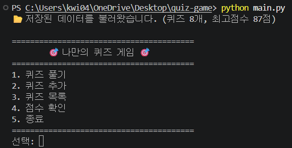
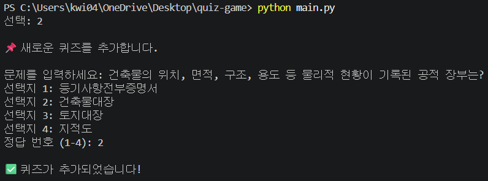
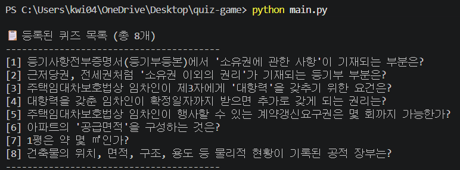
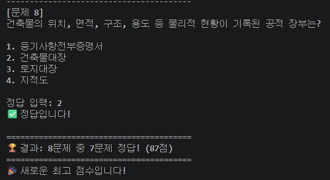
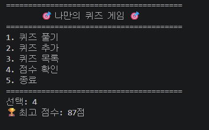

# 🎯 나만의 퀴즈 게임 (부동산 상식)

파이썬 콘솔에서 동작하는 4지선다 퀴즈 게임입니다. 퀴즈를 풀고, 직접 퀴즈를 추가하고, 최고 점수를 기록하며, 프로그램을 종료해도 데이터가 유지됩니다.

## 1. 프로젝트 개요

- **무엇을 만들었나:** 터미널에서 메뉴 번호로 조작하는 퀴즈 게임입니다. 퀴즈 풀기, 퀴즈 추가, 퀴즈 목록, 최고 점수 확인 기능이 있습니다.
- **데이터 영속성:** 추가한 퀴즈와 최고 점수는 `state.json`에 저장되어 프로그램을 다시 실행해도 유지됩니다.
- **코드 구조:** `Quiz`(퀴즈 한 문제)와 `QuizGame`(게임 전체 관리) 두 개의 클래스로 역할을 나누었습니다.
- **개발 환경:** Python 3.10 이상, 외부 라이브러리 없이 표준 라이브러리(`json`, `pathlib`)만 사용했습니다.
- **버전 관리:** Git으로 기능 단위 커밋을 남기고, `feature/play-quiz` 브랜치에서 작업한 뒤 `main`에 병합했습니다.

## 2. 퀴즈 주제와 선정 이유

**주제: 부동산 상식**

1. **스스로 검증할 수 있는 분야입니다.** 부동산 분야에서 일하는 경험이 있어서 문제와 정답을 직접 만들고 맞는지 확인할 수 있었습니다.
2. **퀴즈 형식과 잘 맞습니다.** 등기부등본의 구성, 임차인의 권리(대항력, 우선변제권, 계약갱신요구권), 면적 개념처럼 일상에서 자주 접하지만 헷갈리기 쉬운 지식은 4지선다로 묻고 답하기에 좋습니다.
3. **정답이 분명한 기본 개념 위주로 구성했습니다.** 세율이나 대출 한도처럼 자주 바뀌는 수치는 문제에서 제외해 정답이 오래 유지되도록 했습니다.

> 참고: 퀴즈는 학습용 기본 개념이며, 법령은 개정될 수 있으므로 실제 거래나 계약에서는 최신 법령과 전문가의 확인이 필요합니다.

## 3. 실행 방법

**필요한 것:** Python 3.10 이상 (`python --version`으로 확인)

```
git clone https://github.com/kwi******-co***/quiz-game.git
cd quiz-game
python main.py
```

- 처음 실행하면 기본 퀴즈 7개로 시작하고, `state.json`이 자동으로 만들어집니다.
- Windows에서 `python`이 실행되지 않으면 `py main.py`를, macOS에서는 `python3 main.py`를 사용합니다.
- 프로그램을 끝내려면 메뉴에서 `5`를 입력합니다. (`Ctrl + C`로 중단해도 데이터를 저장하고 종료합니다.)

## 4. 기능 목록

| 기능 | 설명 |
|---|---|
| 퀴즈 풀기 | 등록된 퀴즈를 순서대로 출제하고, 정답/오답 여부와 최종 결과(100점 만점 환산)를 보여줍니다. 퀴즈가 없으면 안내합니다. |
| 퀴즈 추가 | 문제, 선택지 4개, 정답 번호를 입력받아 등록하고 바로 저장합니다. |
| 퀴즈 목록 | 등록된 퀴즈의 문제를 번호와 함께 보여줍니다. 퀴즈가 없으면 안내합니다. |
| 점수 확인 | 최고 점수를 보여줍니다. 퀴즈를 풀 때마다 비교하여 갱신하고, 풀어 본 적이 없으면 안내합니다. |
| 데이터 저장/불러오기 | `state.json`에 UTF-8로 저장합니다. 파일이 없으면 기본 퀴즈로 시작하고, 손상되었으면 안내 후 기본 데이터로 복구합니다. |
| 입력 검증 | 앞뒤 공백 제거, 숫자가 아닌 입력, 범위 밖 숫자, 빈 입력을 안내 후 다시 입력받습니다. |
| 안전한 종료 | `Ctrl + C`나 입력 스트림 종료가 발생해도 오류 화면 없이 저장 후 종료합니다. |

## 5. 파일 구조

```
quiz-game/
├── main.py              # 프로그램 시작점
├── quiz.py              # Quiz 클래스 (퀴즈 한 문제)
├── quiz_game.py         # QuizGame 클래스 (메뉴, 게임 진행, 저장/불러오기)
├── input_utils.py       # 공통 입력 함수 (숫자·문자열 입력 검증)
├── default_quizzes.py   # 기본 퀴즈 데이터 (부동산 상식 7문제)
├── state.json           # 퀴즈와 최고 점수 저장 파일 (실행 시 자동 생성, Git 제외)
├── .gitignore
├── README.md
└── docs/
    └── screenshots/     # 실행 화면 이미지
```

| 파일 | 역할 |
|---|---|
| `main.py` | `QuizGame` 객체를 만들어 실행합니다. |
| `quiz.py` | 문제, 선택지, 정답을 가진 `Quiz` 클래스. 문제 출력, 정답 확인, 저장용 변환 메서드가 있습니다. |
| `quiz_game.py` | `QuizGame` 클래스. 퀴즈 목록과 최고 점수를 관리하고 메뉴 기능과 파일 저장/불러오기를 담당합니다. |
| `input_utils.py` | `read_int`, `read_text`. 잘못된 입력은 안내하고 올바른 값이 나올 때까지 다시 묻습니다. |
| `default_quizzes.py` | 처음 실행하거나 저장 파일이 손상되었을 때 사용하는 기본 퀴즈입니다. |

## 6. 데이터 파일 설명 (state.json)

- **경로:** 프로젝트 루트의 `state.json` (어느 폴더에서 실행해도 같은 파일을 사용)
- **역할:** 퀴즈 목록과 최고 점수를 저장해 프로그램을 다시 실행해도 유지되게 합니다.
- **인코딩:** UTF-8 (한글이 그대로 저장됨)
- **Git 관리:** 실행할 때마다 바뀌는 사용자 데이터이므로 `.gitignore`로 제외했습니다.

```json
{
    "quizzes": [
        {
            "question": "등기사항전부증명서(등기부등본)에서 '소유권에 관한 사항'이 기재되는 부분은?",
            "choices": ["표제부", "갑구", "을구", "건축물대장"],
            "answer": 2
        }
    ],
    "best_score": 87
}
```

| 필드 | 타입 | 설명 |
|---|---|---|
| `quizzes` | 리스트 | 퀴즈 목록 |
| `quizzes[].question` | 문자열 | 문제 |
| `quizzes[].choices` | 문자열 4개의 리스트 | 선택지 |
| `quizzes[].answer` | 정수 (1~4) | 정답 번호 |
| `best_score` | 정수 (0~100) 또는 `null` | 최고 점수 (100점 만점 환산, 아직 풀지 않았으면 `null`) |

**저장·불러오기 규칙**

- 저장 시점: 퀴즈를 추가한 직후, 새 최고 점수가 나온 직후, 프로그램을 종료할 때(`Ctrl + C` 포함)
- 파일이 없으면 기본 퀴즈 7개로 시작합니다.
- 파일이 깨졌거나 형식이 올바르지 않으면 안내 메시지를 출력하고 기본 데이터로 초기화합니다.
- 저장은 임시 파일에 먼저 쓴 뒤 교체하는 방식이라, 저장 도중 문제가 생겨도 기존 파일이 망가지지 않습니다.

## 7. 실행 화면

**메뉴 (재시작 후 저장된 데이터를 불러온 모습)**



**퀴즈 추가**



**퀴즈 목록**



**퀴즈 풀기와 결과**



**점수 확인**



## 8. 개발 과정 (Git)

- `Feat:`, `Fix:`, `Docs:`, `Refactor:` 접두어로 작업 내용이 드러나는 커밋 메시지를 사용했습니다.
- 퀴즈 풀기 기능은 `feature/play-quiz` 브랜치에서 개발한 뒤 `main`에 병합했습니다.
- 저장소를 별도 폴더에 `clone`하여 수정·`push`한 뒤, 원래 작업 폴더에서 `pull`로 반영되는지 확인했습니다.


> clone 실습: 이 줄은 clone한 별도 폴더(quiz-game-clone)에서 작성해 push한 뒤, 원래 폴더에서 pull로 가져왔습니다.